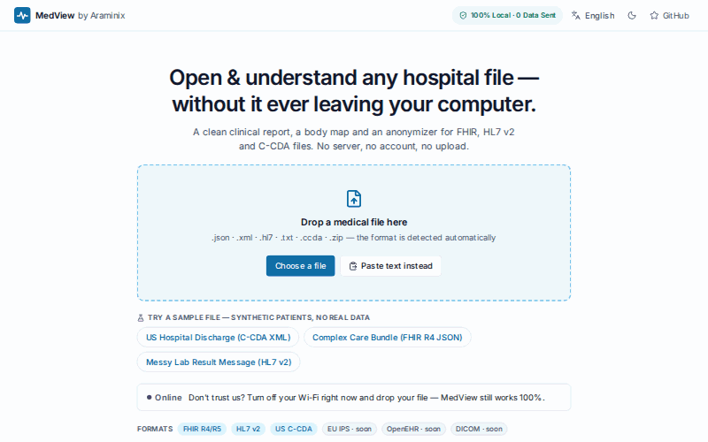
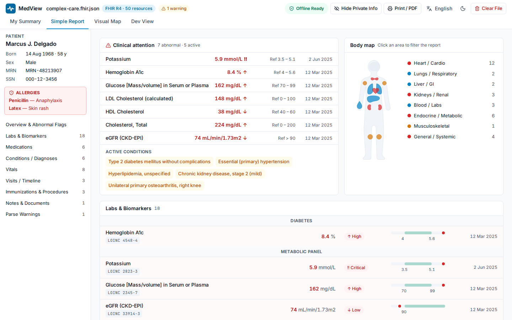
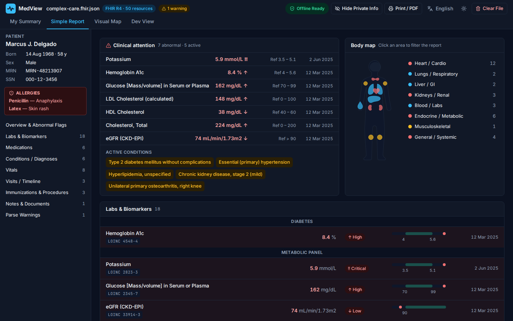
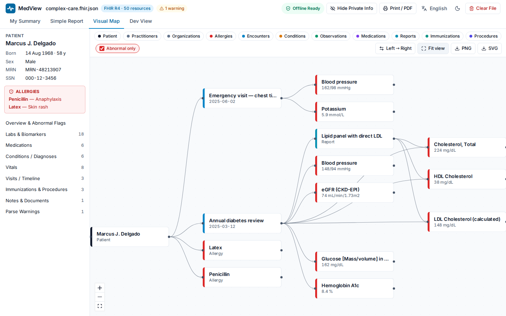

# MedView

**Open and understand any hospital file — without it ever leaving your computer.**

MedView is a free, browser-only viewer for medical files. Drop a hospital file, an Apple Health export or a scan and get a clean clinical report, an interactive body map, a resource graph, an image viewer and a one-click anonymizer. There is no server: the file is parsed in a Web Worker on your device and is gone when you close the tab.

**Live app:** https://araminix.github.io/medview/

<a href="https://araminix.github.io/medview/"></a>

<a href="https://araminix.github.io/medview/"></a>

| Dark theme | Visual Map |
|---|---|
|  |  |

## What it does

| For | You get |
|---|---|
| Clinicians | Allergies pinned at the top, abnormal labs first with ↑/↓ and reference-range bars, a clean one-page print |
| Patients | **My Summary**: what is wrong, how serious it is and what you can do, in everyday words — plus a body map you can click to filter |
| HealthTech developers | Auto-detected parsing with line-level warnings, a resource graph with PNG/SVG export, FHIRPath, and a PHI scrubber that keeps the file valid |

## Formats

The format is detected from the content, never from the file name. Zip archives are opened automatically.

| Format | What is read |
|---|---|
| **FHIR R4 / R5** | JSON and XML, bundles or single resources |
| **HL7 v2.x** | Pipe messages: ADT, ORU, ORM, VXU |
| **US C-CDA** | Continuity of care and discharge documents |
| **EU IPS** | International Patient Summary documents. "No known allergies" and similar statements are shown as notes, not as findings |
| **openEHR** | Canonical compositions in JSON or XML: vital signs, laboratory results, problems, allergies, medication, procedures. The flat and structured web-template formats are not read |
| **Apple Health** | `export.zip` or `export.xml` from an iPhone. The file is read in pieces, so very large exports work: each measurement shows its latest reading, daily totals are a 30-day average, and the clinical records inside the export are merged in. It is converted to a FHIR bundle on your device, so FHIRPath and the scrubber work on it |
| **DICOM** | One file, or a zip of a study. Uncompressed and RLE pictures are decoded here and baseline JPEG by the browser, with brightness and contrast for greyscale scans. JPEG 2000, JPEG-LS and lossless JPEG show their details but not their picture |

The image viewer is for looking, not for diagnosis: it is not calibrated like a radiology workstation.

## Languages

The interface and the health guidance are available in **English, فارسی (Persian) and Türkçe (Turkish)**; the browser language is used on a first visit and the choice is remembered. Persian is laid out right to left. A few things are deliberate:

- Persian shows dates in the Jalali (Solar Hijri) calendar and numbers in Persian digits; English and Turkish use the Gregorian calendar and Western digits. Codes, units and identifiers (`HbA1c`, `mL/min/1.73m2`, an MRN) are never converted.
- Code, raw payloads and the resource diagram stay left to right.
- Content that comes from the file (lab names, drug names, diagnoses) and the technical parse warnings are shown as written.

All dictionaries are bundled, so switching language makes no network request. To add a language, add a file in `src/i18n/locales/` — TypeScript reports any key it is missing — and list it in `src/i18n/languages.ts`.

## Privacy, and how to check it yourself

- The file never leaves your device. There is no backend, no account, no cookies, no analytics and no external fonts.
- A strict Content-Security-Policy blocks every connection to other origins.
- Patient data lives only in memory. `localStorage` holds two UI preferences (theme, last tab) and nothing else.
- **Clear File** terminates the worker that holds the file.

Verify in ten seconds: open DevTools → Network, drop a file, and watch zero requests go out. Or turn off Wi-Fi and reload — the app keeps working, and the privacy panel turns green.

This is enforced in CI: a Playwright test loads every format, visits every tab, runs the scrubber and the exports, and fails the build if a single request is made after the page has loaded.

## My Summary, and what it will not do

The first tab explains the file for someone with no medical background: each problem gets a plain headline, what the file shows, everyday habits that generally help (food, movement, sleep) and questions to bring to a doctor. Results at levels laboratories treat as dangerous are marked urgent, with the date of the result, because an old critical value may already have been treated.

It is rule-based and runs on your device. It does not diagnose, and it deliberately recommends no medicines or supplements — not even over-the-counter ones — because what is safe depends on a person's other conditions, medicines and allergies. Where a common painkiller is risky (for example with kidney disease) it says so and points to a pharmacist.

## The PHI scrubber

*Hide Private Info* replaces names, masks the birth date down to the year, swaps identifiers for synthetic hashes, strips contact details and (optionally) masks provider names. It works on the raw text, so the output is still valid FHIR JSON, HL7 v2, C-CDA or openEHR, and lab values, units and codes are untouched.

A DICOM file is rewritten in place instead: each private value is overwritten by a stand-in of the same length, so the file keeps its size and its picture. Text burned into the picture itself, unique study identifiers and vendor-specific fields are **not** changed. A zipped study is downloaded as a zip again.

Known limit: a bare middle initial (the `J.` in `Marcus J. Delgado`) is kept, because replacing single letters across a file would damage clinical text. Free-text notes are swept for names, phone numbers, e-mails and SSN-like numbers, but no automatic scrubber can promise to catch every identifying phrase in narrative text — read the result before sharing it.

## Development

```bash
pnpm install
pnpm dev            # http://localhost:5173/medview/
pnpm test           # unit tests (parsers, scrubber, engine, graph)
pnpm build && pnpm test:e2e   # Playwright against the production build
pnpm lint && pnpm typecheck
```

The first E2E run needs a browser: `pnpm exec playwright install chromium`.

### Structure

```
src/
  domain/      ClinicalRecord schema and clinical logic (dates, lab flags, body systems)
  parsers/     fhir/ · hl7v2/ · ccda/ · openehr/ · appleHealth/ · dicom/ — each maps its format to a ClinicalRecord
  scrubber/    PHI collection and replacement
  engine/      the Web Worker that owns the open file, and its typed client
  i18n/        dictionaries (en, fa, tr), translation and locale-aware formatting
  features/    landing · workspace · summary · report · graph · imaging · dev · privacy · scrubber · print
  components/  shared UI building blocks
  samples/     seven synthetic sample files (no real patient data); `scripts/` rebuilds them
tests/
  unit/        Vitest
  e2e/         Playwright: privacy, offline, security, UI, performance
```

Every parser targets one schema, `ClinicalRecord` (`src/domain/types.ts`), and the UI only ever reads that. Adding a format means adding a parser, not a screen.

### Deploying

Pushing to `main` runs the full suite and deploys `dist/` to GitHub Pages. For a custom domain served from the root, build with `MEDVIEW_BASE=/ pnpm build`.

## Disclaimer

MedView is not a medical device and does not give medical advice. Always verify against the official hospital source.

## License

MIT © Araminix
